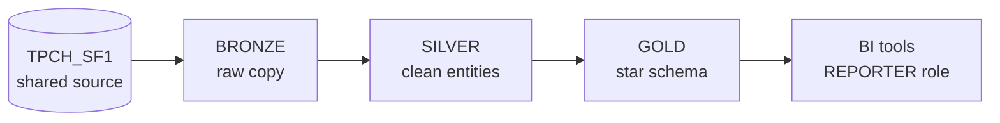

# Sales performance on a Medallion architecture

An end-to-end Medallion architecture on Snowflake, built entirely with dbt over the TPC-H sample data (`SNOWFLAKE_SAMPLE_DATA.TPCH_SF1`). The Gold layer is a star schema for sales performance.

| Layer | Schema | Job | Tables |
| --- | --- | --- | --- |
| Bronze | `BRONZE` | Unchanged copy of the source, plus load metadata | 8 |
| Silver | `SILVER` | Clean, readable, tested entities and one definition of every measure | 8 |
| Gold | `GOLD` | Star schema for BI tools: `fct_sales` and 5 dimensions | 6 |

22 tables and 142 tests. A full `dbt build` takes about 25 seconds on an XSMALL warehouse.



TPC-H is synthetic benchmark data, so its numbers show no real business patterns. The project demonstrates the architecture, not sales insights.

## The Gold star schema

`fct_sales` has one row per order line (6,001,215 rows), with keys and measures only.

| Table | Rows | Holds |
| --- | --- | --- |
| `fct_sales` | 6,001,215 | Quantity, revenue, tax, cost, margin, late and returned counts |
| `dim_date` | 2,557 | One row per day; joined 4 times (order, ship, commit, receipt) |
| `dim_customer` | 150,000 | Segment, nation, region, whether they ever ordered |
| `dim_part` | 200,000 | Brand, type, material, container |
| `dim_supplier` | 10,000 | Name, nation, region |
| `dim_sale_attributes` | 1,120 | Status, priority and shipping combinations (junk dimension) |

**Example question:** net revenue by region and year.

```sql
select d.year_number, c.customer_region, sum(f.net_amount) as net_revenue
from gold.fct_sales f
join gold.dim_date d on f.order_date_key = d.date_key
join gold.dim_customer c on f.customer_sk = c.customer_sk
group by 1, 2
order by 1, 2;
```

## Project layout

```text
models/bronze/          One-line models that copy each source table
models/silver/          Renames, decoded codes, revenue and delivery measures
models/gold/            Star schema, plus one ephemeral preparation model
macros/                 ingest_raw, date_to_key, generate_schema_name, drop_ci_schemas
tests/                  Singular reconciliation tests
tests/generic/          column_total_matches, the custom generic test
analyses/               profile_bronze, the data profiling queries
snowflake_setup/        setup.sql: warehouse, database, schemas, roles, service user
.github/workflows/      ci.yml (pull requests) and deploy.yml (merges to main)
```

## Setup

You need a Snowflake account with `ACCOUNTADMIN`, Python 3.12 and OpenSSL.

**1. Create a key pair for the dbt service user.** The private key stays on your machine and is git-ignored.

```bash
mkdir -p .secrets && chmod 700 .secrets
openssl genrsa 2048 | openssl pkcs8 -topk8 -nocrypt -out .secrets/dbt_svc_key.p8
chmod 600 .secrets/dbt_svc_key.p8
openssl rsa -in .secrets/dbt_svc_key.p8 -pubout -outform DER | openssl base64 -A
```

**2. Prepare Snowflake.** Open `snowflake_setup/setup.sql`, replace the value of `RSA_PUBLIC_KEY` with the output of the last command, and run the whole script as `ACCOUNTADMIN`. In Snowsight, use the arrow beside Run and choose Run All.

**3. Install dbt and connect.**

```bash
python3.12 -m venv .venv
.venv/bin/pip install -r requirements.txt
cp .env.example .env        # then put your account in .env
source .env
.venv/bin/dbt deps
.venv/bin/dbt debug         # should end with "All checks passed!"
```

**4. Build and test everything.**

```bash
.venv/bin/dbt build
```

## Everyday commands

| Command | What it does |
| --- | --- |
| `dbt build` | Builds and tests everything, in dependency order |
| `dbt build --select tag:gold` | Builds and tests one layer |
| `dbt test` | Runs all 142 tests |
| `dbt test --select test_name:column_total_matches` | Runs only the custom test |
| `dbt docs generate` then `dbt docs serve` | Opens the documentation site and lineage graph |

Run them from the project root after `source .env`, with `.venv/bin/` in front of `dbt`.

## How the data is tested

| Layer | Tests | The question it asks |
| --- | --- | --- |
| Bronze and sources | 20 | Did the copy arrive complete? |
| Silver | 62 | Are the values valid, and do the tables link up? |
| Gold | 60 | Is the star intact, with no sales lost? |

The custom generic test `column_total_matches` compares the total of a column with the total of a column in another table. It runs on 12 columns, following the money from the source to Gold. Two singular tests reconcile line totals with order totals and Gold with Silver.

## Documentation and lineage

```bash
.venv/bin/dbt docs generate
.venv/bin/dbt docs serve
```

Click the blue icon at the bottom right of the site to open the lineage graph. It runs from the source tables through Bronze and Silver to Gold.

## CI/CD

| Workflow | Runs on | What it does |
| --- | --- | --- |
| `ci.yml` | Every pull request to `main` | Builds and tests the project in its own schemas (`CI_PR_42_BRONZE`, ...), then drops them |
| `deploy.yml` | Every merge to `main` | Rebuilds the real layers and publishes the docs to GitHub Pages |

To enable them on your own copy:

1. Add three repository secrets under **Settings > Secrets and variables > Actions**: `SNOWFLAKE_ACCOUNT`, `SNOWFLAKE_USER` and `SNOWFLAKE_PRIVATE_KEY` (the full contents of the `.p8` file).
2. Under **Settings > Pages**, set **Source** to **GitHub Actions**. Pages on a private repository needs a paid GitHub plan.
3. Under **Settings > Branches**, protect `main` and require the `build-and-test` check to pass.

## Security

- No secrets live in the repository. `profiles.yml` reads connection details from environment variables.
- dbt signs in with an RSA key pair as a service user, so no password or MFA prompt is involved.
- The `TRANSFORMER` role builds the tables. The `REPORTER` role can read Gold only.

## What production would add

- Separate development and production databases, and a separate service user per environment
- Slim CI, which builds only the models a pull request changed
- Incremental models for large fact tables, and snapshots for dimension history
- Source freshness checks, unit tests for the revenue formulas, and alerts when a test fails
- Actions pinned to exact commit hashes, and scheduled rotation of the key pair
